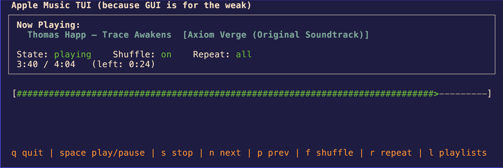
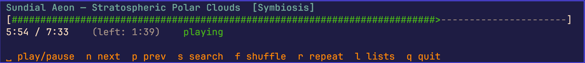
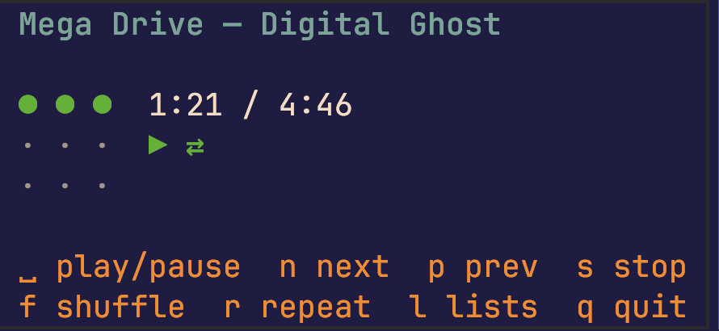

# music_tui

`music_tui` is a terminal-based (ncurses) controller for **Apple Music on macOS**.
It provides a keyboard-driven TUI for playback control, now-playing status, progress tracking, playlist selection, and shuffle/repeat management -- all without leaving the terminal.

This project uses **Python**, **curses**, and **AppleScript (osascript)** to control the native Music app. No DRM hacks, no reverse engineering, and no browser tabs were harmed.

---



## Features

- Full-screen (or window) ncurses TUI with color-coded display
- Now Playing display (artist, track, album) with box border layout
- Playback state indicator with color coding (playing / paused / stopped)
- Progress bar with playhead marker, elapsed time, and time remaining
- Shuffle state display and toggle
- Repeat state display and cycling (off / one / all)
- Transient flash notifications for user actions
- Adaptive layout that adjusts to terminal width and height
- Compact layout for small terminals, with a 3x3 dot-grid progress indicator in place of the progress bar
- Wide layout for short-but-wide terminals, keeping the horizontal bar and putting every control on one line
- Keyboard controls for:
  - Play / pause toggle
  - Stop
  - Next / previous track
  - Shuffle toggle
  - Repeat cycle
- Playlist browser
  - Enumerates user playlists (folder playlists excluded)
  - Keyboard navigation
  - Play selected playlist
- Library search
  - Matches song names and artist names in one pass
  - Keyboard navigation of results
  - Plays the selected track by persistent ID, so renames do not break it
- Pure terminal workflow (works well with tmux / Kitty panes)
- ASCII fallback for terminals or fonts without good Unicode coverage

---

## Requirements

- macOS
- Python 3.9+ (system Python is fine)
- Apple Music app
- Terminal with curses support (Terminal.app, iTerm2, Kitty, etc.)

No third-party Python libraries are required.

**NOTE:** Python can be installed on MacOS via homebrew. For example, if you wanted to install Python version 3.13:

```bash
brew install python@3.13
```

---

## Installation

Clone the repository:

```bash
git clone https://github.com/asyrewicze/music_tui.git
cd music_tui
```

Make the script executable:

```bash
chmod +x music_tui.py
```

---

## Usage

Run the TUI:

```bash
./music_tui.py
```

The Music app does not need to be running beforehand; macOS will launch it automatically if required.

---

## Keyboard Controls

### Main View

| Key | Action |
|---|---|
| Space | Play / pause toggle |
| n | Next track |
| p | Previous track |
| s | Search the library |
| f | Toggle shuffle |
| r | Cycle repeat mode (off / one / all) |
| l | Open playlist browser |
| q | Quit |

### Playlist Browser

| Key | Action |
|---|---|
| Up / Down | Navigate playlists |
| j / k | Navigate playlists (Vim-style) |
| Enter | Play selected playlist |
| b or Esc | Return to main view |
| q | Quit |

### Search

Pressing `s` opens a query prompt. While typing, every printable key is treated as
query text -- `q` types a `q` rather than quitting.

| Key | Action |
|---|---|
| (any printable key) | Add to the query |
| Backspace | Delete the last character |
| Enter | Run the search |
| Esc | Cancel, back to main view |

Once results are listed:

| Key | Action |
|---|---|
| Up / Down | Navigate results |
| j / k | Navigate results (Vim-style) |
| Enter | Play the selected track |
| b or Esc | Back to the query, to refine it |
| q | Quit |

---

## Permissions (Important)

macOS requires explicit permission for terminal applications to control other apps.

On first run, you may be prompted to allow your terminal to control **Music**.

If nothing responds:

1. Open **System Settings**
2. Go to **Privacy & Security -> Automation**
3. Allow your terminal application (Terminal, iTerm2, Kitty, etc.) to control **Music**

Without this permission, AppleScript commands will silently fail.

---

## How It Works

- The TUI is rendered using Python `curses`
- Playback and metadata are queried via `osascript`
- Apple Music's scripting dictionary provides:
  - Player state
  - Current track metadata
  - Playback position
  - Shuffle and repeat state
  - Playlist enumeration
  - Library search by song name and artist name
- Playlists are enumerated safely using manual AppleScript iteration to avoid list coercion issues
- Folder playlists are excluded from the browser as they cannot be played directly
- Search runs both a song-name and an artist-name pass in a single osascript call, then
  de-duplicates by persistent ID in Python (de-duping a list in AppleScript is quadratic)
- Search results are played by persistent ID rather than by name, so duplicate or renamed
  titles still resolve to the exact track you picked

### Layouts

The UI picks one of four layouts each frame, based on the current terminal size.
They are tested in this order, so the first one that fits wins:

| Condition | Layout |
|---|---|
| 40 cols and 16 rows or more | **Full** -- boxed now-playing panel, horizontal progress bar, wrapped key menu |
| 60 cols and 5 rows or more | **Wide** -- too short for the full layout, but wide enough that the dot grid would waste the space |
| 20 cols and 8 rows or more | **Compact** -- see below |
| anything smaller | "Terminal too small" message |

### Wide layout

Five rows: title, a normal horizontal progress bar, one status line, a gap, and a
single control line at the bottom.



The status line drops its least important segments as the width shrinks -- time
remaining goes first, then the shuffle/repeat flags (shown only when they are on, so
neither appears above). The control line uses the same
label ladder as the compact layout, just on one row instead of two. 60 columns is the
floor because that is where all eight bindings still fit with readable labels.

The list views (playlists, search) are shared with the compact layout -- they are
already height-efficient and simply use whatever width they are given.

### Compact layout

Eight rows -- title, blank, three dot-grid rows, blank, and two rows of controls:



The 3x3 dot grid is the progress indicator. It fills in reading order -- left to
right, top to bottom -- one dot per ninth of the track, with the dot currently
playing shown in bold. Elapsed/total time sits beside the first row, and the
playback state plus shuffle/repeat symbols beside the second.

The bottom two rows list every binding, four per row. They shorten as the terminal
narrows -- full words, then full words with tighter spacing, then abbreviations
(`play`, `find`, `shuf`, `rep`), then bare keys once labels stop fitting at all
(below 29 columns):

```
 ␣  n  p  s
 f  r  l  q
```

The playlist browser works the same way in the compact layout: `l` opens a stripped
list in the same reduced area, with names truncated with an ellipsis rather than
clipped, and a footer showing position and the keys that fit.

Resizing moves between all four layouts with no restart, in any direction, including
while the playlist browser or a search is open.

The compact layout is purely a rendering path -- it reads the same cached state and does
not change the polling cadence or add any osascript calls.

Unicode glyphs (dots, shuffle/repeat symbols, ellipses) are used when the
terminal encoding supports them. Set `MUSIC_TUI_ASCII=1` to force plain ASCII:

```bash
MUSIC_TUI_ASCII=1 ./music_tui.py
```

### Timing Model

The app uses two separate timing mechanisms to minimize AppleScript calls:

- **Slow poll (every 10 seconds)** -- fetches authoritative state from Apple Music via a single consolidated osascript call
- **Local interpolation (every 1 second)** -- advances the playback position counter in the UI without any osascript call

This keeps CPU usage low while maintaining a responsive, smoothly ticking UI. Any user action (play, pause, next, etc.) triggers an immediate state refresh outside the normal poll cycle.

This approach uses Apple's supported automation interfaces and is resilient across macOS updates.

---

## Limitations

- macOS only (depends on AppleScript)
- No album art (ncurses is character-cell based)
- Playlist selection is name-based (duplicate playlist names may resolve unpredictably); search
  results are not, and use persistent IDs
- Search matches song and artist names only -- not albums or composers -- and is capped at 200
  results
- Search queries accept printable ASCII only; accented characters cannot be typed into the
  query (searching for a substring without them usually still matches)
- A search blocks the UI while it runs, since the app is single-threaded
- No audio visualizer (AppleScript does not provide access to the audio stream)

---

## Possible Future Enhancements

- Filtering within the playlist browser
- Album and composer search areas
- Volume control
- Persistent state (last playlist, last view)
- Playing by persistent playlist ID instead of name
- Kitty/iTerm-specific enhancements (optional, non-portable)

---

## License

GPLv3 (GNU General Public License v3.0) License

---

## Disclaimer

This project is not affiliated with or endorsed by Apple.
Apple Music and macOS are trademarks of Apple Inc.
